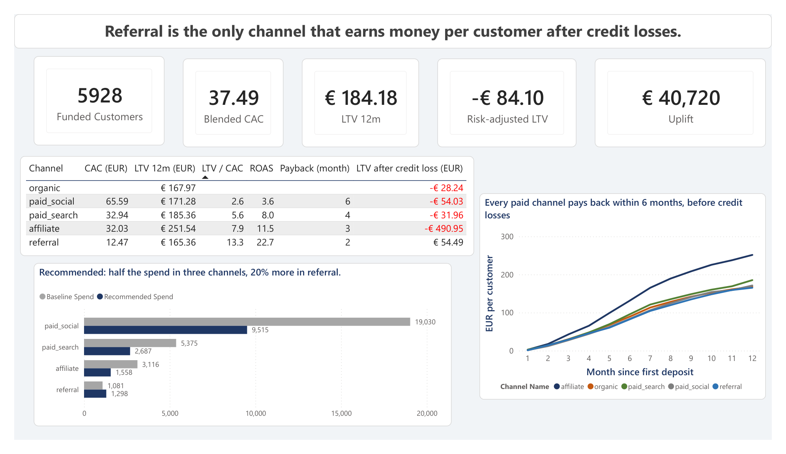
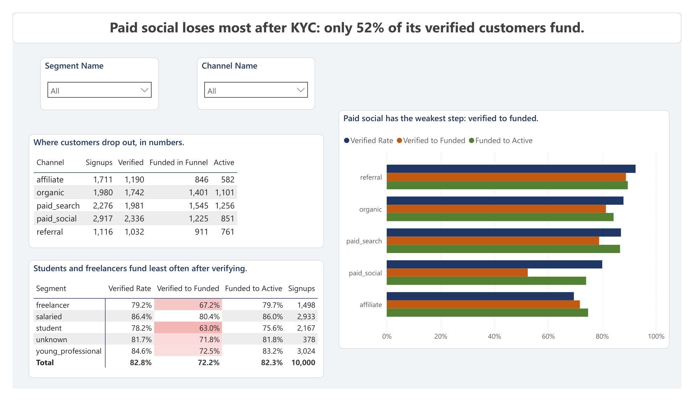
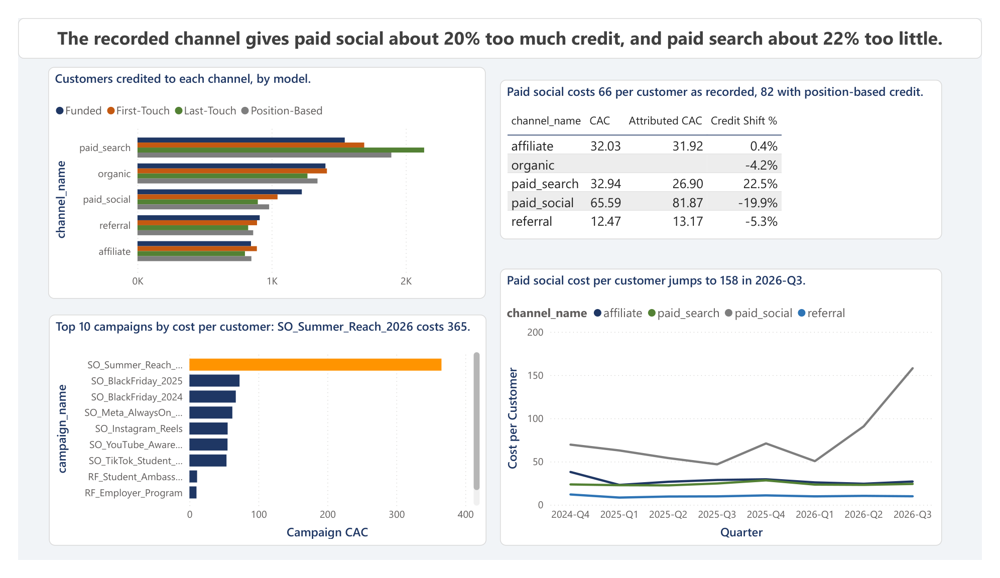
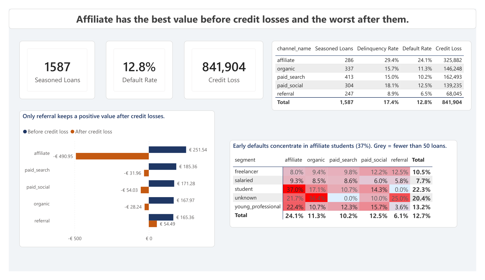
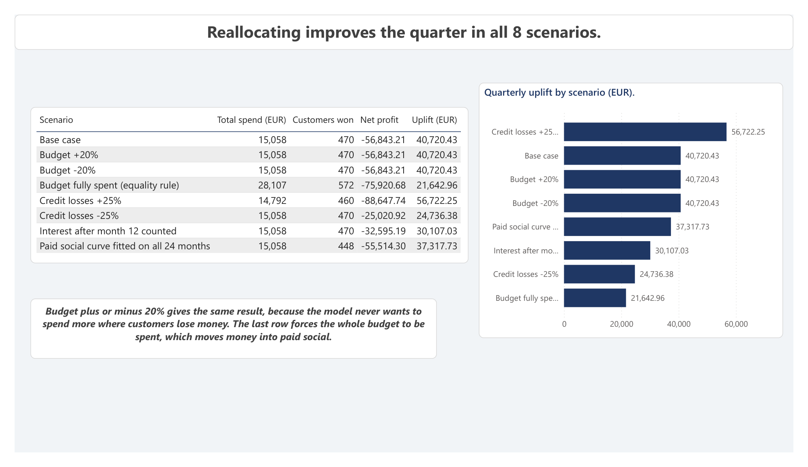

# Case Study: Which Acquisition Channels Bring Profitable Customers?

**A customer acquisition and profitability analysis for a fictional fintech company**
SQL Server · Excel (Solver) · Power BI

> **The short version:** Every paid channel earns back its acquisition cost within six months, but once credit losses are counted only referral earns money per customer (+54.49 EUR over 12 months, against -84.10 EUR for all customers together). Affiliate looks best before credit losses (251.54 EUR) and is the worst after them (-490.95 EUR), because 24.1% of its loans default. In the Excel model, spending half as much on affiliate, paid search and paid social, and 20% more on referral, improves the quarter by about 40,700 EUR. That is a model estimate, not a tested result.

[Video walkthrough (3 min)](https://www.youtube.com/watch?v=IQ7_uw7gf64) · [Dashboard report (PDF)](power_bi/Customer_Acquisition_Analysis.pdf) · [Executive summary (PDF)](Executive_Summary.pdf) · [Code and documentation](README.md)

---

## The question

A fictional fintech company has two years of data and one decision to make: next quarter's marketing budget. Which channels bring customers who are worth what they cost, and where should the money go? I set out to answer five smaller questions first:

1. Where do we lose people between signup and an active account, and does it differ by channel?
2. Which channels earn back what we paid to win a customer, and how fast?
3. Is the channel recorded at signup giving too much credit to some channel?
4. Which campaigns waste money?
5. Which channels bring customers who do not repay their loans?

The answers feed one headline question: how should the budget be reallocated?

## The data, and what I fixed before analysing it

The data is synthetic. I generated it with Python for a made-up company, with ten tables and 136,098 rows: 10,000 customers, 64,908 transactions, 21,019 ad touchpoints, 2,290 loans and 19,190 loan installments, from October 2024 to September 2026. The credit part follows the published grade mix of LendingClub, but the default behaviour and the marketing behaviour are my own assumptions. The findings therefore describe this simulation, not a real bank.

Before any analysis I profiled the tables and cleaned them in T-SQL, because every number below depends on who counts as a customer:

- 100 customer records were duplicates: 60 exact copies, and 40 re-signups with the same email in a different case. I kept the original record of each person, which leaves 10,000 customers.
- Eight odd channel names (`ppc`, `fb/ig_ads`, `aff_network` and similar) were mapped to the five real channels. I checked the mapping against each customer's first click.
- 323 transactions had the wrong sign, and 389 happened before the account was open. I fixed the signs, flagged the early ones, and changed nothing else, because nothing says which of the two dates is wrong.
- 378 customers have no segment. They are labelled `unknown`, not guessed.
- Loans issued after 2026-03-31 are too young to reach 90 days past due. I flagged 703 of the 2,290 loans, and all default rates use the other 1,587 only.

Only the customers table loses rows. Every other table keeps all of its rows, and each fix keeps the original value beside the new one.

## What I did, and why

| Step | Method | Why this method |
|---|---|---|
| Profile and clean | T-SQL, 18 triage decisions, one script per step | A channel comparison is only fair if each customer is counted once and in one channel. |
| Build reporting views | Ten SQL views (funnel, margin by month, scorecard, attribution, credit) | One definition of CAC, LTV and default that SQL, Excel and Power BI all read. |
| Answer five questions | SQL with CTEs and window functions | Each question has a query, a result and a decision. |
| Reallocate the budget | Excel model: response curves, then Solver | A curve says how many customers an extra euro buys, and Solver finds the best split under limits. |
| Test the answer | Eight scenarios in Excel | A recommendation that breaks when one assumption moves should not be trusted. |
| Report | Five-page Power BI report, 41 DAX measures | A non-technical reader can follow it page by page. |

Two choices matter for the numbers. CAC includes 2.50 EUR per KYC decision, not only ad spend. And LTV is the margin actually observed in the first 12 months, then reduced by the credit loss per customer, because a customer who defaults is not worth the interest they paid before.

## What I found

**1. Every paid channel pays back fast, before credit losses.** Referral costs 12.47 EUR per customer and pays back in month 2. Affiliate (32.03) takes 3 months, paid search (32.94) 4 and paid social (65.59) 6. LTV/CAC runs from 13.3 for referral to 2.6 for paid social.

**2. Paid social loses people after KYC.** Only 52.4% of its verified customers make a first deposit, against 72% to 89% in the other channels. Affiliate loses earlier: only 69.5% of its signups pass KYC. Students (63.0%) and freelancers (67.2%) fund less often than salaried customers (80.4%).

**3. The recorded channel gives paid social about 20% too much credit.** When I credit each customer to every click before the first deposit (40% first, 40% last, 20% shared by the middle clicks), paid social loses 19.9% of its customers and paid search gains 22.5%. Paid social CAC rises from 65.59 to 81.87 and paid search falls from 32.94 to 26.90, which makes paid search cheaper than affiliate.

**4. One campaign wastes money.** SO_Summer_Reach_2026 (paid social, June to September 2026) costs 365 EUR per customer, against a channel median of 62. It took 18,124 EUR, 24.5% of paid social spend, and brought about 50 customers. Paid social cost per customer in 2026-Q3 is 158 EUR, up from 47 to 91 in the earlier quarters.

**5. After credit losses only referral is positive.** Credit loss over the 1,587 seasoned loans is 841,904 EUR and 12.8% of loans default. Affiliate defaults on 24.1% (others 6.5% to 12.5%) and has the largest credit loss of any channel (325,882 EUR) from the smallest number of loans (286). The problem is concentrated: 37.0% of affiliate students show an early default.

**6. A smaller, shifted budget beats the current one in all eight scenarios.** The optimizer cuts affiliate, paid search and paid social by half and raises referral by 20% (referral is capped at 120% of its baseline, because it is the smallest channel and may not scale). Total spend falls from 28,603 to 15,058 EUR, and the modelled net profit of the quarter improves from -97,564 to -56,843 EUR, an uplift of 40,720 EUR. The uplift is between 21,643 and 56,722 EUR across the eight scenarios.

## What I would recommend

These are hypotheses to test, in this order of confidence. None of them has been tested.

1. **Stop the Summer Reach style of spend in paid social.** One campaign took a quarter of the channel's budget at five to six times the normal cost per customer. This is the strongest finding because it does not depend on the model.
2. **Change how affiliate customers are accepted, before changing how much is spent on affiliate.** Its acquisition cost is fine; its credit losses are not. Tighter credit rules for affiliate students are a smaller step than cutting a channel that has the best value before credit losses.
3. **Move money to referral, in steps.** Referral is the only channel with positive value after credit losses, but it is the smallest, and a 20% increase is a test of whether it scales, not a plan.
4. **Report channel results with position-based credit next to the recorded channel.** Paid search is probably better, and paid social worse, than the recorded numbers say.
5. **Look at why paid social customers verify but do not fund.** Moving the same step to a cheaper channel would not fix a 52% rate.

## How much to trust this

- **The data is synthetic.** The ranking of channels is a property of my simulation. The method carries over to real data, the numbers do not.
- **Credit risk is the weakest part.** Default behaviour is an assumption, loans after 2026-03-31 carry no loss yet (so the loss is a floor), and cells with fewer than 50 loans are greyed out in the report and should not be read as findings.
- **The curves are rough.** Each response curve has 24 monthly points and an R squared between 0.25 and 0.70. The paid social curve predicts 74 customers a month at its baseline spend against 40 won, because of the Summer Reach campaign. I leave those months out of its fit by default.
- **LTV is conservative.** Credit loss covers the life of a loan while LTV covers 12 months, so interest after month 12 (about 44 to 69 EUR per customer) is not counted. Counting it moves the uplift to 30,107 EUR and does not change the recommendation.
- **Marketing cannot fix profitability alone.** The modelled quarter is still a loss after reallocation, because most of the loss comes from loan losses that marketing spend does not change.
- **Attribution counts clicks only.** First touch, last touch and position-based are conventions, not measurements of what caused a signup.

The full list is in [Assumptions and Limitations](docs/Assumptions_and_Limitations.md).

## What I would do next

- Look at retention by channel. A quick check shows about 9% of paid social customers and 11% of affiliate customers still transacting in month 12, against 44% for referral. I left retention and RFM out on purpose, because the first project covers them, but this would be the first thing to add.
- Test the recommendation with a holdout: change the budget in one market or one month and compare, before moving the whole budget.
- Fit the curves on weekly data instead of monthly, to get more than 24 points per channel.
- Add a credit-risk cut by loan grade and amount, so the affiliate result can be explained by who borrows, not only by which channel brought them.

---

*Built by Giannis Psomas. Questions or feedback are welcome: [LinkedIn](https://www.linkedin.com/in/giannispsomas/) · [GitHub](https://github.com/giannispsomas)*
