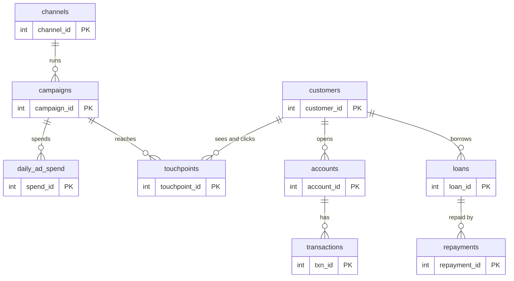
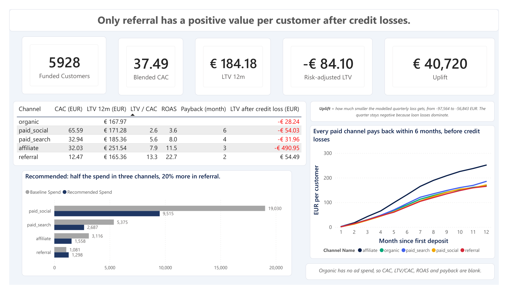
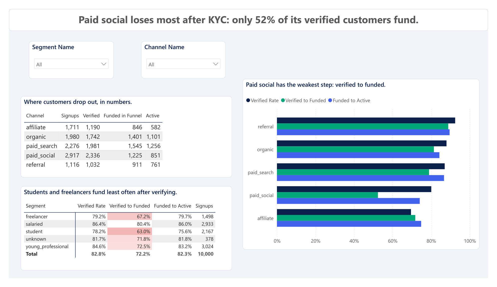
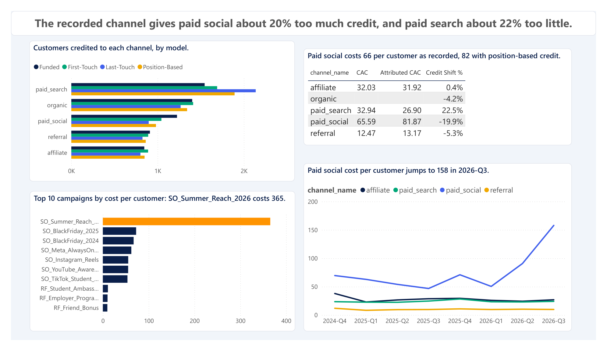
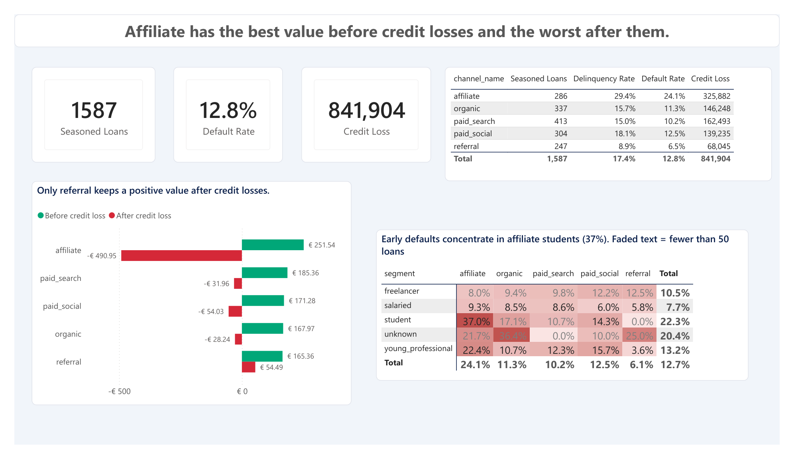
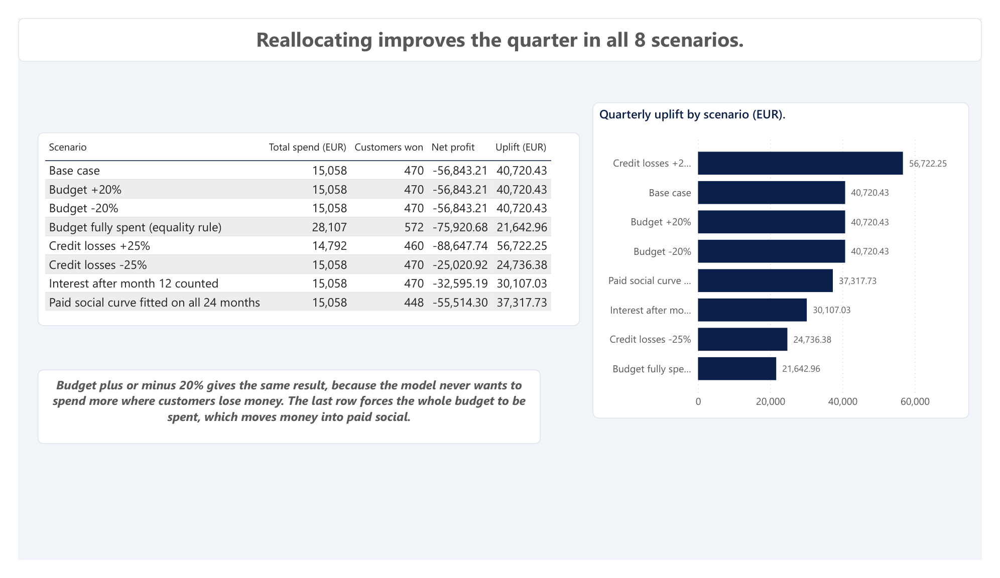

# FinTech Customer Acquisition and Profitability Analysis

An analysis of customer acquisition for a fictional fintech company: 10,000 customers, 24 months and about 136,000 rows across 10 tables. The project takes raw data through SQL Server and Excel to answer one question: **which acquisition channels bring profitable customers, and how should next quarter's marketing budget be reallocated?**

**Tools:** SQL Server (T-SQL) · Excel (Solver) · Power BI · Python

**Start here:** [Video walkthrough (3 min)](https://www.youtube.com/watch?v=IQ7_uw7gf64) · [Case study](Case_Study.md) · [Dashboard report (PDF)](power_bi/Customer_Acquisition_Analysis.pdf) · [Executive summary (PDF)](Executive_Summary.pdf) · [Slides (PPTX)](Executive_Summary_Slides.pptx)

> The data is **synthetic**. It was generated with Python (fixed seed). The credit part is shaped after LendingClub's published grade mix and APR range. Default rates and all marketing and banking behaviour are assumptions. The company, its customers and its numbers are not real.

## Project Background

Meltemi Bank is a fictional mobile-only digital bank based in Athens, with customers in eight European countries. Everything happens in the app: signing up, identity checks (KYC), deposits, card payments and loans. The bank earns card interchange and loan interest and fees. It pays for advertising, identity checks, servicing, the cost of the money it lends, and credit losses.

Over 24 months (October 2024 to September 2026) the growth team spent about EUR 150,000 on acquisition and brought in about 10,000 signups. The team is measured on signups, and reporting credits whichever channel was clicked last. Nobody had measured which channels bring customers who earn more than they cost, or linked the acquisition source to loan repayment. I took the role of the analyst answering the Data Director's brief ahead of the Q4 2026 budget decision. Insights and recommendations are provided on five areas:

- **Funnel:** where prospects drop out between signup and an active account.
- **Payback and attribution:** which channels earn back their cost, and whether the recorded channel is fair.
- **Campaigns:** which campaigns waste money.
- **Credit risk:** which sources bring customers who do not repay.
- **Budget reallocation:** where next quarter's money should go.

The SQL queries used to inspect and clean the data are in [01_data_profiling.sql](sql/01_data_profiling.sql) and [02_data_cleaning.sql](sql/02_data_cleaning.sql). The reporting views are in [03_reporting_views.sql](sql/03_reporting_views.sql) and the queries for each business question in [04_business_questions.sql](sql/04_business_questions.sql). The Excel Solver model is in [excel/](excel/), and the Power BI report is in [power_bi/](power_bi/), with a [PDF version](power_bi/Customer_Acquisition_Analysis.pdf).

## Data Structure and Initial Checks

The raw data is ten tables and 136,098 rows over 24 months. The raw layer is intentionally not clean: it has duplicates, spelling variants and sign errors, and 100 duplicate customer records are removed in cleaning, which leaves 10,000 customers.



| Table | One row per | Rows |
|---|---|---|
| channels | acquisition channel | 5 |
| campaigns | marketing campaign | 25 |
| daily_ad_spend | campaign and active day | 8,747 |
| customers | signup record | 10,100 |
| touchpoints | marketing interaction before signup | 21,019 |
| accounts | account | 9,806 |
| transactions | account transaction | 64,908 |
| loans | loan | 2,290 |
| repayments | scheduled loan instalment | 19,190 |
| assumptions | revenue or cost assumption | 8 |

- **Data model:** no star schema. The project is about marketing analytics, so the operational tables stay as they are and ten reporting views in the `rpt` schema sit on top. Every metric is defined once in those views, and the exploratory analysis, the Excel model and the Power BI report all read from them. Details in [reporting_views.md](docs/reporting_views.md).
- **Table grain:** each view states its grain, for example one row per funded customer (5,928), per funded customer and 30-day month (71,136), or per channel (5).
- **Measures:** 56 DAX measures, among them CAC, LTV 12m, LTV to CAC, payback month, risk-adjusted LTV, default rate and verified-to-funded rate. Each is listed in [DAX_Measures.md](docs/DAX_Measures.md).
- **Headline metric:** risk-adjusted LTV per customer, which is the 12-month margin after credit losses.
- **Data layers:** `dbo` (raw, never changed), `clean` (cleaned copy) and `rpt` (reporting views). See [data_cleaning.md](docs/data_cleaning.md) and [data_profiling.md](docs/data_profiling.md).
- **KPI scorecard:** six targets per channel (CAC, LTV to CAC, payback, risk-adjusted LTV, default rate, verified to funded), explained in [Report_Guide.md](docs/Report_Guide.md).

## Executive Summary

- **Before credit loss, every paid channel pays back its acquisition cost within 12 months** (referral in month 2, paid social in month 6). **After credit loss, only referral has a positive average per customer** (+54 EUR, against -28 to -491 EUR for the other channels). Bootstrap intervals show affiliate is clearly the worst, while referral's positive value is not yet proven ([details](docs/Statistical_Comparison.md)).
- **Affiliate has the best 12-month value (252 EUR per customer) but the worst credit risk:** 24% of its seasoned loans default, against 6.5% to 12.5% elsewhere, concentrated in students.
- **Paid social is the most expensive channel** (CAC 65.59 EUR) and **one campaign wastes money:** SO_Summer_Reach_2026 costs 365 EUR per customer against a channel median of 62.
- **The model's best allocation** puts affiliate, paid search and paid social at half of their baseline spend and referral 20% above it. It improves the quarter by about 40,700 EUR, but the net result stays negative because loan losses dominate. The biggest lever is credit policy, not channel mix.

**Skills shown:** data profiling and cleaning in T-SQL · reporting views with window functions and CTEs · attribution (first touch, last touch, position-based) · payback and LTV by cohort of months · response curves, Solver optimization and scenarios in Excel · a six-page Power BI report with DAX measures · documenting assumptions and limits honestly.



The full story, with the ranked recommendations, is in the **[case study](Case_Study.md)**. The slides and the one-page summary are linked at the top.

## Insights Deep Dive

### Funnel

- **Paid social loses people after KYC.** Only 52.4% of its verified customers make a first deposit, against 72% to 89% in the other channels.
- **Affiliate loses earlier.** Only 69.5% of its signups pass KYC.
- **Segments differ.** Students (63.0%) and freelancers (67.2%) fund less often than salaried customers (80.4%).



### Payback and attribution

- **Every paid channel pays back fast, before credit losses.** Referral costs 12.47 EUR per customer and pays back in month 2. Affiliate (32.03) takes 3 months, paid search (32.94) 4 and paid social (65.59) 6.
- **The recorded channel gives paid social about 20% too much credit.** With position-based credit, paid social CAC rises from 65.59 to 81.87 and paid search falls from 32.94 to 26.90, which makes paid search cheaper than affiliate.



### Campaigns

- **One campaign wastes money.** SO_Summer_Reach_2026 (paid social) costs 365 EUR per customer against a channel median of 62. It took 18,124 EUR, 24.5% of paid social spend, and brought about 50 customers.
- **Paid social cost per customer in 2026-Q3 is 158 EUR,** up from 47 to 91 in the earlier quarters.

### Credit risk

- **After credit losses only referral has a positive average** (+54.49 EUR per customer). Credit loss over the 1,587 seasoned loans is 841,904 EUR and 12.8% of loans default.
- **Affiliate defaults on 24.1% of its loans** (others 6.5% to 12.5%) and has the largest credit loss (325,882 EUR) from the smallest number of loans (286). Early defaults reach 37.0% in affiliate students.
- **What is proven and what is not.** A bootstrap shows affiliate is clearly the worst channel after credit losses. Referral's positive value is not proven: its 95% interval runs from -44 to +131 EUR ([Statistical_Comparison.md](docs/Statistical_Comparison.md)).



### Budget reallocation

- **A smaller, shifted budget beats the current one in all eight scenarios.** The optimizer halves affiliate, paid search and paid social and raises referral by 20%. Spend falls from 28,603 to 15,058 EUR, and the modelled net profit of the quarter improves from -97,564 to -56,843 EUR, an uplift of 40,720 EUR.
- **The quarter stays negative.** Loan losses dominate, so the biggest lever is credit policy, not channel mix.



## Recommendations

Based on the findings above, I would recommend the growth, risk and finance teams consider the following. These are hypotheses to test, in this order of confidence, and **none has been tested**.

- One paid social campaign took a quarter of the channel's budget at five to six times the normal cost per customer. **Stop the Summer Reach style of spend.** This is the strongest finding because it does not depend on the model.
- Affiliate's acquisition cost is fine, its credit losses are not. **Tighten credit rules for the riskiest grades and for students before cutting affiliate spend.**
- Referral is the only channel with positive value after credit losses, but it is the smallest. **Move money to referral in steps,** as a test of whether it scales.
- Paid social is probably worse, and paid search better, than the recorded numbers say. **Report channel results with position-based credit next to the recorded channel.**
- Only 52% of verified paid social customers fund. **Look at why they verify but do not fund,** because moving the same step to a cheaper channel would not fix it.

## Assumptions and Caveats

### Definitions and assumptions

The full list is in [Assumptions_and_Limitations.md](docs/Assumptions_and_Limitations.md). The key ones:

- **Funded customer:** a customer with a first deposit. This is the acquired customer.
- **CAC:** (ad spend + 2.50 EUR per KYC decision) divided by funded customers. Organic has no ad spend, so it has no CAC.
- **LTV:** the observed margin per customer over the first 12 months. **Risk-adjusted LTV** subtracts the credit loss on that customer's loans.
- **Seasoned loan:** issued on or before 2026-03-31. Default rates use only seasoned loans.
- **Attribution:** position-based credit (40% first click, 40% last click, 20% shared by the middle clicks), compared with first touch, last touch and the recorded channel.

### Limitations

The ones that matter most:

- **The data is generated,** so the channel ranking is a property of the simulation. The method carries over to real data, the numbers do not.
- **Referral's positive value after credit losses is not proven.** Its 95% interval (-44 to +131 EUR) includes zero. Affiliate being the worst channel, and paid social having the highest CAC, are clear ([Statistical_Comparison.md](docs/Statistical_Comparison.md)).
- **Credit risk is the weakest part.** Default behaviour is an assumption, loans issued after 2026-03-31 carry no loss yet, and the credit model is cross-validated on only 1,587 loans ([Credit_Risk_Model.md](docs/Credit_Risk_Model.md)).
- **The response curves are rough** (24 monthly points per channel), and the optimizer's result depends on the assumed value per customer ([LTV_Scenarios.md](docs/LTV_Scenarios.md)).
- **The recommendation is a hypothesis** that has not been tested, for example with a holdout. The KPI targets on the last report page are illustrative.

## Technical Details

Everything below is for readers who want to inspect or reproduce the work.

### Project Overview

**Business problem:** which acquisition channels bring customers who pay back their cost, and how should the budget move between channels?

**Approach**

1. **SQL Server:** profile and clean the raw data, then define every metric once in reporting views ([sql/](sql/)).
2. **Excel:** unit economics, response curves per channel and a Solver budget optimizer with scenarios ([excel/](excel/)).
3. **Python:** bootstrap confidence intervals for CAC and LTV by channel, and a logistic regression credit risk model ([python/](python/)).
4. **Power BI:** a six-page report on the reporting views and the Excel results, with 56 DAX measures ([power_bi/](power_bi/)).

The data goes through three layers: `dbo` (raw, never changed), `clean` (cleaned copy) and `rpt` (reporting views).

### Dashboard

The report has six pages: Executive, Funnel, Attribution and campaigns, Credit risk, Budget scenarios, and KPI scorecard. The full PDF is [power_bi/Customer_Acquisition_Analysis.pdf](power_bi/Customer_Acquisition_Analysis.pdf), and every page is explained in [Report_Guide.md](docs/Report_Guide.md).

### Repository Structure

```
FinTech-Customer-Acquisition-and-Profitability-Analysis/
├── README.md                        Project overview (this file)
├── Case_Study.md                    The question, method, findings and recommendations
├── Case_Study.pdf                   The same case study as a PDF
├── Executive_Summary.pdf            Executive summary for business readers
├── Executive_Summary_Slides.pptx    The same story as 7 slides
├── LICENSE                          MIT license
├── data/                            The 10 CSV files
├── docs/                            Supporting documentation
│   ├── data_profiling.md            Profiling of the raw data
│   ├── data_cleaning.md             Cleaning steps and row counts
│   ├── reporting_views.md           The reporting layer: grain, rules and checks of each view
│   ├── Business_Questions.md        Business questions, methods and findings
│   ├── Statistical_Comparison.md    Bootstrap intervals for CAC and LTV by channel
│   ├── Credit_Risk_Model.md         Logistic regression on loan defaults, by channel
│   ├── LTV_Scenarios.md             Optimizer re-run with optimistic and pessimistic channel values
│   ├── Assumptions_and_Limitations.md   Definitions, assumptions and limits
│   ├── DAX_Measures.md              The 56 DAX measures of the report
│   └── Report_Guide.md              Page-by-page guide to the Power BI report
├── python/                          Python analysis (bootstrap intervals, credit risk model)
├── sql/                             T-SQL scripts (profiling, cleaning, reporting views, business questions)
│   ├── 01_data_profiling.sql
│   ├── 02_data_cleaning.sql
│   ├── 03_reporting_views.sql
│   └── 04_business_questions.sql
├── excel/                           Excel model
│   ├── budget_model.xlsx            Unit economics, response curves, Solver optimizer, scenarios
│   └── Excel_Model_Walkthrough.pdf  Sheet-by-sheet walkthrough of the model, as a worked example
└── power_bi/                        Power BI report
    ├── Customer_Acquisition_Analysis.pbix   The report (6 pages)
    ├── Customer_Acquisition_Analysis.pdf    PDF export of the report
    ├── Customer_Acquisition_Theme.json      Colour theme
    └── images/                      One screenshot per page
```

### Documentation

| Document | What it covers |
|---|---|
| [data_profiling.md](docs/data_profiling.md) | The 93 checks, the 18 findings and the decision for each |
| [data_cleaning.md](docs/data_cleaning.md) | The cleaning rules, the row count log and the validation |
| [reporting_views.md](docs/reporting_views.md) | The ten reporting views, their design decisions and checks |
| [Business_Questions.md](docs/Business_Questions.md) | Each business question, its method and its finding |
| [Executive_Summary_Slides.pptx](Executive_Summary_Slides.pptx) | A 7-slide presentation of the question, findings, recommendations and limits |
| [Statistical_Comparison.md](docs/Statistical_Comparison.md) | Bootstrap confidence intervals for CAC and LTV: which channel differences are more than chance |
| [LTV_Scenarios.md](docs/LTV_Scenarios.md) | The budget optimizer re-run with each channel's value at the low and high end of its bootstrap interval |
| [Credit_Risk_Model.md](docs/Credit_Risk_Model.md) | A logistic regression on loan defaults: why affiliate defaults more, and what the channel adds |
| [Assumptions_and_Limitations.md](docs/Assumptions_and_Limitations.md) | Definitions, assumptions, and what the analysis cannot conclude |
| [DAX_Measures.md](docs/DAX_Measures.md) | Every DAX measure of the report, its formula and the number to check it against |
| [Report_Guide.md](docs/Report_Guide.md) | The data model and a page-by-page guide to the Power BI report |

### Dataset

- **Source:** generated with Python.
- **Tables:** channels, campaigns, daily_ad_spend, customers, touchpoints, accounts, transactions, loans, repayments, assumptions.
- **Size:** 136,098 rows over 24 months (October 2024 to September 2026). The extract date is 2026-09-30.
- **Messiness:** the raw tables contain data quality problems, such as duplicates, spelling variants and sign errors. 100 duplicate customer records are removed in the cleaning step, which leaves 10,000 customers.

> The CSV files are included in `data/` because the data is small enough to share.

### Reproducing the Project

#### Environment
- SQL Server (developed on SQL Server Express) and SQL Server Management Studio
- Excel with the Solver add-in enabled
- Power BI Desktop (to open the report)
- Python 3 with the packages in `requirements.txt` (for the bootstrap analysis)

#### Steps

1. **Create the database.** Create a database named `NeobankGrowth`.
2. **Load the data into SQL Server.** Load the CSV files from `data/` into schema `dbo` with the **Import Flat File** wizard in SQL Server Management Studio; there is no import script. Use the table names `channels`, `campaigns`, `daily_ad_spend`, `customers`, `touchpoints`, `accounts`, `transactions`, `loans`, `repayments` and `assumptions`.
3. **Run the SQL scripts** in [sql/](sql/) in numbered order, from `01_data_profiling.sql` through `04_business_questions.sql`. `01` only reads. `02` builds the clean tables, `03` builds the reporting views, and `04` holds the analysis queries.
4. **Open the Excel model** in [excel/](excel/). The data sheets hold the results of the SQL views. To refresh them, run the views again and paste the results. Press Solve in the `Optimizer` sheet to rerun the optimization.
5. **Run the Python analysis** (optional): `pip install -r requirements.txt`, then `python python/01_channel_bootstrap.py` and `python python/02_credit_risk_model.py` from the repository root. They read the `rpt` views and write the results and the figure to `python/`.
6. **Open the Power BI report** [power_bi/Customer_Acquisition_Analysis.pbix](power_bi/Customer_Acquisition_Analysis.pbix). It reads the `rpt` views from the `NeobankGrowth` database on `.\SQLEXPRESS` with Windows authentication, and the two result tables from `excel/budget_model.xlsx`. If your server or file path differs, change the data source in Transform data, then Data source settings.

### About the author

Giannis Psomas. Data analyst portfolio project.

- LinkedIn: [giannispsomas](https://www.linkedin.com/in/giannispsomas)
- GitHub: [giannispsomas](https://github.com/giannispsomas)

### License

The code in this repository is released under the [MIT License](LICENSE).
