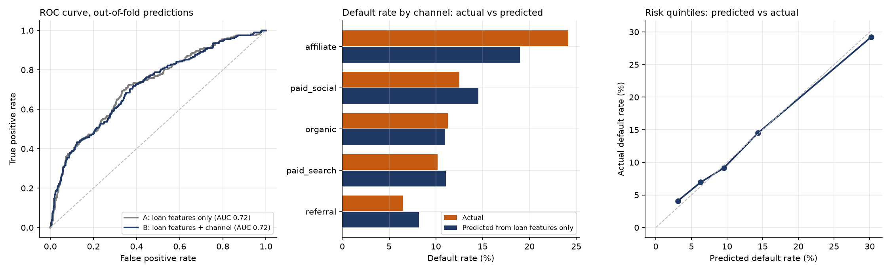

# Credit Risk Model

The scorecard shows that affiliate customers default far more than the others (24.1% of seasoned loans, against 6.5% to 12.5%). This note asks why: is it the channel, or the kind of loans and borrowers the channel brings? The code is [python/02_credit_risk_model.py](../python/02_credit_risk_model.py), and the results are in `python/results/`.

## Method

- **Data:** the 1,587 seasoned loans (issued on or before 2026-03-31), with a 90+ days past due default as the target. The default rate is 12.8%.
- **Model:** logistic regression, because it is simple, explainable and enough to rank risk.
- **Two models are compared:**
  - **A, loan features only:** grade, borrower segment, log of principal and term.
  - **B, loan features plus channel.**
  - APR is left out because it is set by grade, and it would repeat what grade already says.
- **Evaluation:** ROC-AUC with 5-fold cross-validation repeated 10 times, and out-of-fold predictions (each loan is scored by a model that never saw it) for every table and chart below.

## Results

**The model separates risk, and the channel adds nothing to that**

| Model | ROC-AUC (mean of 50 folds) | 95% range of folds |
|---|---|---|
| A: loan features only | 0.729 | 0.65 to 0.81 |
| B: loan features plus channel | 0.723 | 0.65 to 0.81 |

An AUC of 0.73 is a useful but moderate separation. Knowing the channel does not improve it.

**Calibration.** Loans sorted into five groups by predicted risk have actual default rates close to the predicted ones (lowest group 3.1% predicted and 4.1% actual, highest 30.2% predicted and 29.2% actual). The highest-risk fifth of loans holds 7 times the default rate of the lowest fifth.

**Why affiliate defaults more**

| Channel | Loans | Actual default rate | Predicted from loan features only | Gap (95% interval) | Share of its loans in the highest-risk fifth |
|---|---|---|---|---|---|
| affiliate | 286 | 24.1% | 19.0% | +5.1 points (+0.7 to +9.8) | 61% |
| paid social | 304 | 12.5% | 14.5% | -2.0 points (-5.6 to +1.6) | 18% |
| organic | 337 | 11.3% | 10.9% | +0.3 points (-2.8 to +3.8) | 13% |
| paid search | 413 | 10.2% | 11.1% | -0.9 points (-3.8 to +2.1) | 10% |
| referral | 247 | 6.5% | 8.2% | -1.7 points (-4.6 to +1.5) | 2% |

- **Most of the affiliate problem is the loan mix.** Affiliate brings many more loans in the riskiest grades (E, F and G are 22% of its loans, against 2% to 11% elsewhere) and many students. On loan features alone the model already predicts 19.0% for affiliate, against 12.8% overall.
- **A smaller part is left over.** Affiliate defaults 5.1 points more than its loan mix predicts, and the interval (+0.7 to +9.8) only just excludes zero. The other four channels are within chance of their predicted rates.
- **In the model with the channel included,** affiliate has an odds ratio of 1.49 against the average channel. The riskiest grades are larger effects: grade E has an odds ratio of 3.3 and grade A of 0.2.

## What this changes

- Tightening credit rules should target **grade and segment**, not the whole affiliate channel. Cutting affiliate spend removes the risky loans, but so would a rule at the loan level.
- The referral advantage on credit is mostly a loan-mix advantage: only 2% of its loans are in the highest-risk fifth.
- Limits: the loans are synthetic, and their default behaviour is an assumption, so the weights show the generator's rules more than real borrowers. The model is trained and tested on the same 1,587 loans (cross-validated, but not on new loans), and with 203 defaults the intervals are wide. Loans issued after 2026-03-31 are not in the data.
