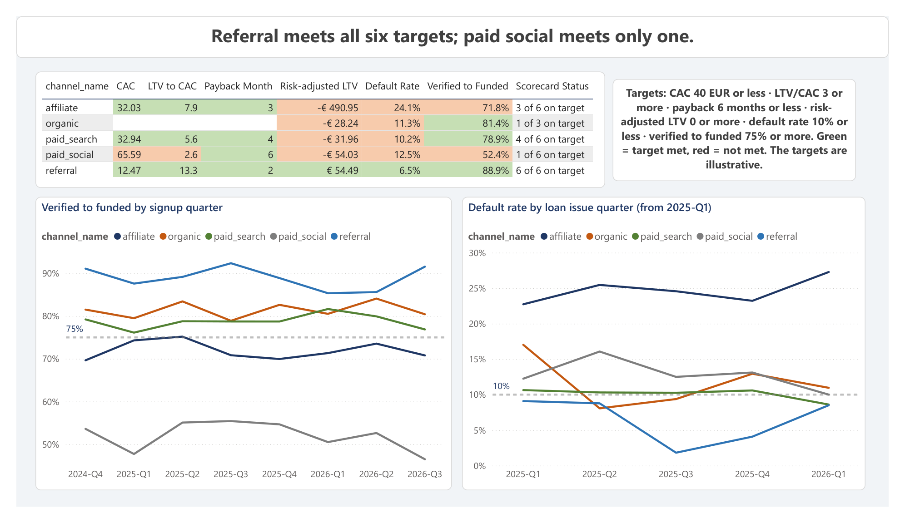

# Report Guide

A page-by-page guide to the Power BI report: what each page shows, which numbers to look at first, and how to read the visuals. The file is `power_bi/Customer_Acquisition_Analysis.pbix`, and a PDF copy of all six pages is in `power_bi/Customer_Acquisition_Analysis.pdf`. The measures behind every number are in [DAX_Measures.md](DAX_Measures.md).

The report answers one question: which acquisition channels bring profitable customers, and how should next quarter's budget be reallocated?

## Data model

The report reads the SQL Server views in the `rpt` schema (Import mode, Windows authentication, no stored credentials) and two tables from the Excel budget model. A small `dim channel` table sits in the middle, so one channel slicer filters every page.

| Table | Source | One row per | Rows |
|---|---|---|---|
| `dim channel` | `clean.channels` | channel | 5 |
| `rpt v_funnel` | `rpt.v_funnel` | customer | 10,000 |
| `rpt v_loan_dpd` | `rpt.v_loan_dpd` | loan | 2,290 |
| `rpt v_touch_credit` | `rpt.v_touch_credit` | funded customer and qualifying click | 10,690 |
| `rpt v_channel_curve` | `rpt.v_channel_curve` | channel and month since first deposit | 60 |
| `rpt v_channel_scorecard` | `rpt.v_channel_scorecard` | channel | 5 |
| `rpt v_credit_by_segment` | `rpt.v_credit_by_segment` | channel and segment | 25 |
| `rpt v_campaign_cac` | `rpt.v_campaign_cac` | campaign | 25 |
| `rpt v_budget_inputs` | `rpt.v_budget_inputs` | paid channel and month | 96 |
| `tblAllocation` | `excel/budget_model.xlsx`, sheet `Optimizer` | channel | 4 |
| `tblScenarios` | `excel/budget_model.xlsx`, sheet `Scenarios` | scenario | 8 |
| `_Measures` | empty table that holds the measures | | |

**Relationships** (all many to one, single direction, from the fact table to `dim channel`)

| From | To |
|---|---|
| `rpt v_channel_scorecard[acquisition_channel]`, `rpt v_funnel`, `rpt v_loan_dpd`, `rpt v_channel_curve`, `rpt v_credit_by_segment` (same column name) | `dim channel[channel_name]` |
| `rpt v_campaign_cac[channel_name]`, `rpt v_budget_inputs[channel_name]` | `dim channel[channel_name]` |
| `rpt v_touch_credit[touch_channel]` | `dim channel[channel_name]` |
| `tblAllocation[Channel]` | `dim channel[channel_name]` |
| `tblScenarios` | not connected (a stand-alone table of eight scenarios) |

The two views `rpt.v_funded_customers` and `rpt.v_customer_month_margin` are not loaded. Their results are already in the scorecard and the curve.

Each page has a takeaway title: a sentence with the main result, so the page can be read without opening a single visual.

---

## Page 1: Executive

**Takeaway:** Only referral has a positive value per customer after credit losses.

| Visual | What it shows |
|---|---|
| Five cards | Funded customers (5,928), blended CAC of the four paid channels (37.49), 12-month LTV (184.18), risk-adjusted LTV (-84.10) and the budget uplift (40,720) |
| Channel scorecard | CAC, 12-month LTV, LTV/CAC, ROAS, payback month and LTV after credit loss for every channel, sorted by LTV/CAC. Negative values are red |
| Payback line | Average cumulative margin per customer, month 1 to 12, one line per channel |
| Spend bars | Baseline spend against recommended spend for the four paid channels |

**How to read it**
- Start with the scorecard. Reading left to right shows a story: CAC is lowest for referral, LTV is highest for affiliate, and the last column turns every channel red except referral.
- The cards mix levels: CAC is for paid channels only, LTV is for all customers. The risk-adjusted LTV card is negative on average, which is why the budget is reduced and not only moved around.
- The payback line is before credit losses. Every paid channel reaches its CAC within six months on this view.
- The spend bars are the Excel Solver result, not a forecast.

---

## Page 2: Funnel

**Takeaway:** Paid social loses most after KYC: only 52% of its verified customers fund.

| Visual | What it shows |
|---|---|
| Two dropdown slicers | Segment and channel. They filter every visual on the page |
| Counts table | Signups, verified, funded and active customers per channel |
| Rates bar chart | Verified rate, verified to funded and funded to active per channel |
| Segment matrix | The same three rates per customer segment. Verified to funded has a red gradient: the darker, the lower |

**How to read it**
- Each rate is the share who reach the next step, not the share of all signups.
- Verified to funded counts only customers who signed up at least 30 days before the extract, and funded to active only customers funded at least 90 days before it, so recent signups do not lower the rates.
- Paid social is the only channel where the orange bar (verified to funded) falls far below the blue one. Affiliate loses earlier, at KYC (69.5% verified).
- By segment, students (63.0%) and freelancers (67.2%) fund least often after verifying.

---

## Page 3: Attribution and campaigns

**Takeaway:** The recorded channel gives paid social about 20% too much credit, and paid search about 22% too little.

| Visual | What it shows |
|---|---|
| Credit bars | Customers credited to each channel by four models: recorded (funded), first touch, last touch and position-based (40% first, 40% last, 20% shared among the middle clicks) |
| CAC table | CAC with the recorded channel, CAC with position-based credit, and the credit shift between them |
| Campaign bars | The ten campaigns with the highest cost per customer. A wasteful campaign is orange |
| Quarter line | Paid channel spend per credited customer by quarter |

**How to read it**
- The recorded channel is the one stored when the customer signed up. The position-based model looks at every click before the first deposit.
- A positive credit shift means the channel gets more customers under position-based credit (paid search +22.5%); a negative shift means fewer (paid social -19.9%). A channel with fewer customers has a higher CAC: paid social goes from 65.59 to 81.87.
- A campaign is marked wasteful when its CAC is at least twice the median of its channel and it spent at least 2,000. Only SO_Summer_Reach_2026 qualifies, with a CAC of 365, and it used 24.5% of paid social spend.
- The quarter line shows paid social at 158 per customer in 2026-Q3, up from 46.84 to 90.88 in earlier quarters.

---

## Page 4: Credit risk

**Takeaway:** Affiliate has the best value before credit losses and the worst after them.

| Visual | What it shows |
|---|---|
| Three cards | Seasoned loans (1,587), default rate (12.8%) and credit loss (841,904) |
| Credit table | Seasoned loans, delinquency rate, default rate and credit loss per channel |
| Before and after bars | 12-month LTV before and after credit loss, per channel |
| Early default heatmap | Early default rate for every segment and channel. Cells with fewer than 50 loans are grey |

**How to read it**
- A seasoned loan is one issued by 2026-03-31, so it had time to default. Younger loans are left out.
- Delinquent means 30 or more days past due, default means 90 or more. Credit loss is 0.9 times the opening balance at the first 90+ day installment.
- Affiliate defaults on 24.1% of its loans (others 6.5% to 12.5%) and its credit loss of 325,882 is the largest, from the smallest group of loans.
- The red cells are mostly in the affiliate column: affiliate students at 37.0% and affiliate young professionals at 22.4%. The dark red cells of 36.4% (unknown, organic) and 25.0% (unknown, referral) sit in the small unknown segment and must be read with care.

---

## Page 5: Budget scenarios

**Takeaway:** Reallocating improves the quarter in all 8 scenarios.

| Visual | What it shows |
|---|---|
| Scenario table | Total spend, customers won, net profit and uplift for the eight scenarios of the Excel model |
| Uplift bars | Uplift against the baseline for each scenario, sorted from high to low |
| Note | Why budget plus or minus 20% gives the same result |

**How to read it**
- Net profit is negative in every row, because at the current spend even the best allocation does not recover the credit losses. The uplift is the improvement against the baseline, not a profit.
- The base case spends 15,058 where the baseline spent 28,603, and wins 470 customers.
- Budget +20% and -20% show the same result because the budget is a ceiling: the optimizer stops spending where a customer loses money.
- "Credit losses +25%" has the largest uplift because the baseline suffers more than the recommended mix. "Budget fully spent" forces the whole budget out and moves money into paid social, which is why it is the smallest uplift.
- The scenarios are what-ifs about the model, not predictions. See [Assumptions_and_Limitations.md](Assumptions_and_Limitations.md).

---

## Page 6: KPI scorecard

**Takeaway:** Referral meets all six targets; paid social meets only one.

| Visual | What it shows |
|---|---|
| Scorecard table | Six KPIs per channel (CAC, LTV/CAC, payback month, risk-adjusted LTV, default rate, verified to funded). A cell is green when the KPI meets its target and red when it does not. The last column counts the targets met |
| Targets note | The six targets and the colour rule |
| Verified to funded line | The verified-to-funded rate by signup quarter, with the 75% target as a dashed line |
| Default rate line | The default rate by loan issue quarter, with the 10% target as a dashed line |

**How to read it**
- The targets are illustrative: there are no real company targets, so they are set at common benchmarks. They sit in six measures (see [DAX_Measures.md](DAX_Measures.md)) and can be changed in one place.
- Referral meets 6 of 6, paid search 4, affiliate 3 and paid social 1. Organic has no CAC, LTV/CAC or payback, so it is scored on the three KPIs it has (1 of 3).
- Paid social is below the 75% line in every quarter (between 46% and 56%), so its funnel problem is long-standing, not recent.
- Affiliate is above the 10% default line in every quarter (22% to 27%). The other channels move around the line, because each has only a few dozen loans per quarter.
- The default-rate line starts in 2025-Q1. The first quarter (2024-Q4) has only 4 to 13 loans per channel and would be misleading.
