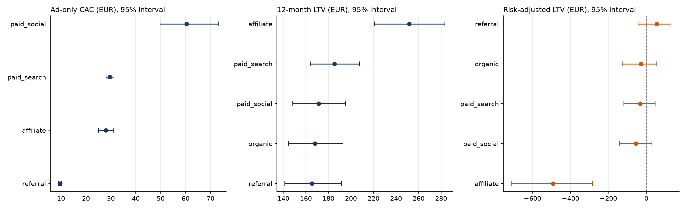

# Statistical Comparison of Channels

The scorecard gives one number per channel. This note asks how much of each difference is more than chance. The code is [python/01_channel_bootstrap.py](../python/01_channel_bootstrap.py), and the results are in `python/results/`.

## Method

A bootstrap resamples the data with replacement 10,000 times, recalculates the metric each time, and takes the 2.5th and 97.5th percentiles as a 95% interval. The seed is fixed (42).

| Metric | What is resampled | Why |
|---|---|---|
| 12-month LTV and risk-adjusted LTV | The customers with a complete month 12 in each channel (382 to 719) | Each customer is one independent observation. Risk-adjusted LTV is the customer's 12-month margin minus the credit loss on their seasoned loans |
| CAC | The 24 months of each paid channel, keeping ad spend and funded customers of the same month together | Spend and customers come as monthly totals, so the month is the unit |

CAC here is **ad-only** (ad spend divided by funded customers), because KYC cost is not available by month. The scorecard CAC adds KYC cost (for example referral 12.47 against 9.57 here). The point estimates for LTV and risk-adjusted LTV match the scorecard exactly.

## Results

| Channel | LTV 12m (95% interval) | Risk-adjusted LTV (95% interval) | Ad-only CAC (95% interval) |
|---|---|---|---|
| referral | 165.36 (141 to 191) | **54.49 (-44 to 131)** | 9.57 (9.0 to 10.2) |
| affiliate | 251.54 (221 to 283) | **-490.95 (-712 to -284)** | 27.99 (25.0 to 31.2) |
| paid search | 185.36 (164 to 208) | -31.96 (-119 to 46) | 29.57 (28.1 to 31.2) |
| paid social | 171.28 (148 to 195) | -54.03 (-142 to 30) | 60.39 (49.7 to 73.2) |
| organic | 167.97 (144 to 193) | -28.24 (-126 to 55) | not applicable |

| Claim | Difference (95% interval) | Share of resamples where it holds |
|---|---|---|
| Affiliate LTV is higher than paid search | +66 (29 to 104) | 100% |
| Affiliate LTV is higher than referral | +86 (47 to 127) | 100% |
| Referral risk-adjusted LTV is higher than affiliate | +545 (321 to 778) | 100% |
| Paid search risk-adjusted LTV is higher than affiliate | +458 (238 to 693) | 100% |
| Referral risk-adjusted LTV is higher than paid search | +86 (-35 to 202) | 92% |
| Referral risk-adjusted LTV is higher than organic | +83 (-43 to 209) | 90% |
| Paid social CAC is higher than paid search | +31 (20 to 44) | 100% |
| Paid social CAC is higher than affiliate | +32 (21 to 45) | 100% |
| Affiliate CAC is higher than referral | +18 (15 to 22) | 100% |

## What holds and what does not

**Holds**
- Paid social is clearly the most expensive channel. Its CAC interval (50 to 73) does not overlap any other channel.
- Referral is clearly the cheapest channel (9.0 to 10.2).
- Affiliate has the highest 12-month LTV, and the gap to every other channel is larger than chance.
- Affiliate is clearly the worst channel after credit losses. Its interval (-712 to -284) is far below all the others.

**Does not hold, or holds less than it looks**
- **Referral earning money per customer.** Its risk-adjusted LTV is +54.49 on average, but the interval (-44 to +131) includes zero. The data say referral is probably better than paid search and organic (90% to 92% of resamples), but not clearly. "Only referral has a positive average" is true. "Referral clearly earns money" is not supported.
- **The ranking of paid search, paid social and organic after credit losses.** Their intervals overlap heavily (all between about -140 and +55). They cannot be ranked against each other.
- **The month-to-month CAC of paid search and affiliate.** Their intervals overlap (28.1 to 31.2 and 25.0 to 31.2), so the 1 euro difference between them is not a finding.

## What this changes

- The recommendation to cut affiliate spend and tighten affiliate credit rules rests on the strongest evidence in the project.
- The recommendation to move money to referral rests on its CAC advantage, which is solid, and on a positive value that is not yet proven. This is another reason to move in steps.
- Limits: the bootstrap shows sampling uncertainty only. It does not cover the assumptions behind the synthetic data, the 12-month cut-off, or the credit loss definition. The customers are treated as independent.
